# Sparse-Sensor Tennis Forehand Inference

A first experiment for detecting forehand phases and estimating trunk (shoulder-line) rotation from a **racket-mounted IMU only**:
accelerometer, gyroscope and on-board orientation, with no body landmarks.

The experiment runs on a physics-based simulator with known ground truth. It checks the method and the physical limits.
It does not measure accuracy on real players.

| deliverable | file |
|---|---|
| two-page technical plan | [`PLAN.md`](PLAN.md) |
| executed notebook | [`notebooks/forehand_experiment.ipynb`](notebooks/forehand_experiment.ipynb) |
| plain-English walkthrough notebook (loads `data/`) | [`notebooks/forehand_walkthrough.ipynb`](notebooks/forehand_walkthrough.ipynb) |
| dataset: data dictionary + a one-session sample (full set regenerates with `export_dataset.py`) | [`data/`](data/README.md) |
| interactive 3D walkthrough (download and open in a browser) | [`site/forehand3d_v2.html`](site/forehand3d_v2.html) |
| explainer website | [`site/index.html`](site/index.html) |
| plain-language explanation | [`EXPLAINED_SIMPLY.md`](EXPLAINED_SIMPLY.md) |
| numbers | [`results/summary.json`](results/summary.json) |

## Architecture

```mermaid
flowchart LR
  subgraph SIM["Simulation layer (src/simulate.py)"]
    P["Player sampler<br/>coil, shoulder share, wrist lag,<br/>tempo, grip, arm length"] --> K["Keyframes per stroke<br/>PCHIP to 1 kHz, 20 Hz low-pass"]
    K --> FK["Forward kinematics<br/>trunk → shoulder → arm → wrist → racket"]
    FK --> IMU["Ideal butt-cap IMU<br/>specific force, body rate, pose"]
    FK --> GT[("Ground truth<br/>phase labels, contact,<br/>trunk yaw")]
    IMU --> COR["Sensor + link model<br/>impact, noise, bias, ±16 g / ±2000 dps,<br/>AHRS drift, jitter, BLE bursts"]
  end
  subgraph PRE["Pre-processing (src/features.py)"]
    COR --> RS["Re-grid on timestamps<br/>interp ≤50 ms, mask longer,<br/>saturation flags"]
    RS --> CH["Heading-free channels<br/>yaw rate about gravity, elevation,<br/>face tilt, jerk"]
    CH --> FF["Multi-scale window features<br/>100 Hz frames × 60"]
  end
  subgraph MOD["Models (src/experiment.py, src/hmm.py)"]
    FF --> LR["LogReg (baseline)"]
    FF --> HGB["Gradient boosting"]
    LR --> HMM["Left-to-right HMM<br/>min durations, flat emission on gaps"]
    HGB --> HMM
    HMM --> EV["Contact snap to impact onset"]
    HMM --> ROT["Trunk-rotation regressors<br/>proxy / GBoost / perfect-sensor control"]
  end
  subgraph EVAL["Evaluation (src/metrics.py)"]
    GT --> M
    EV --> M["LOPO metrics<br/>macro-F1, edit, F1@50,<br/>contact P/R + ms, boundary MAE,<br/>rotation RMSE, peak-coil error"]
    ROT --> M
    M --> OUT[("results/*.json<br/>figures/*.png")]
  end
  OUT --> NB["Notebook"] & WEB["Website"]
  NI["Non-identifiability demo<br/>(src/nonident.py)"] --> OUT
```



**Layers**

* **Simulation**: generates players who differ mainly in how they split racket rotation between trunk, shoulder and wrist, which is the quantity the racket cannot see. It also emits kinematically defined labels.
* **Pre-processing**: turns an irregular, lossy BLE stream into a uniform grid with masks. It only uses quantities that do not depend on the drifting absolute heading.
* **Models**: frame classifiers, a phase-grammar HMM over their posteriors, and rotation regressors. The perfect-sensor regressor separates sensor noise from non-identifiability.
* **Evaluation**: leave-one-player-out over 12 players. Results feed the notebook, the plan and the website.

## Run it

Requires Python 3.11.

```powershell
py -3.11 -m venv .venv
.venv\Scripts\python -m pip install -r requirements.txt
.venv\Scripts\python run_all.py            # ~8 min, writes results/ and figures/
.venv\Scripts\python build_notebook.py
.venv\Scripts\jupyter nbconvert --to notebook --execute --inplace notebooks\forehand_experiment.ipynb
```

## Layout

```
src/simulate.py     kinematic chain, IMU model, corruption
src/features.py     re-gridding, gap masks, heading-free features
src/hmm.py          duration-constrained left-to-right hybrid HMM
src/metrics.py      frame, segment and event metrics
src/experiment.py   LOPO loop, rotation estimation, robustness ablation
src/nonident.py     constructive non-identifiability demo
src/figures.py      all plots
run_all.py          end-to-end run
build_notebook.py   writes the results notebook
export_dataset.py   writes data/ (raw IMU, labels, frame features, players)
build_walkthrough.py writes the walkthrough notebook (reads data/)
site/               explainer website and 3D walkthrough (static HTML)
```
